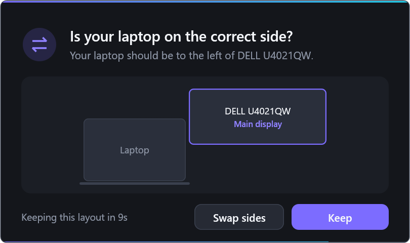
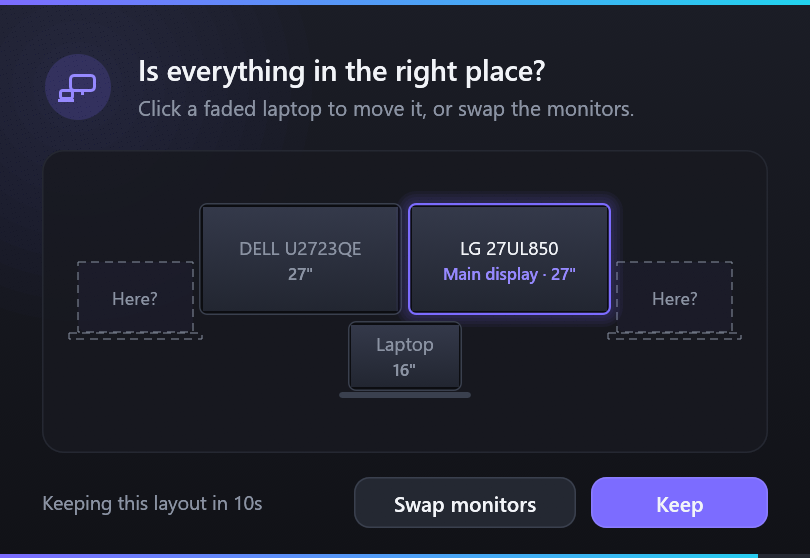

# auto-display

Dock your Windows laptop and the screens come up duplicated? auto-display fixes that. It:

- switches to extend
- makes the external monitor the main display
- sets the scaling you choose

It runs at sign-in and whenever you plug in a monitor. If you switch to duplicate yourself later, for
example to present, it leaves you alone.

## Layout

- **One monitor:** the laptop sits to its left.
- **Two monitors:** side by side, with the right one as the main display and the laptop centred below.

Windows can't tell where your screens physically are, so a card pops up on every screen showing the
layout to scale. Click a faded laptop to move your laptop there (left, right or below), or **Swap
monitors** if two monitors are the wrong way round. **Keep**, or wait 10 seconds, to keep it.

<p>
  
  
</p>

## Install

```powershell
cargo build --release
.\target\release\auto-display.exe install
```

This starts it now and at every sign-in. It doesn't need admin rights.

## Settings

`auto-display config` prints where the settings file is
(`%LOCALAPPDATA%\auto-display\config.toml`):

```toml
external_scale = 150   # scaling for external monitors, in percent
# laptop_scale = 250   # scaling for the laptop screen; leave out to keep what Windows chose
```

## Commands

| Command | What it does |
|---|---|
| `status` | Show your screens, their sizes, and whether auto-display is running |
| `laptop left\|right\|below` | Move the laptop screen |
| `swap` | Swap two monitors |
| `apply` | Fix duplicated screens now |
| `preview` | Show the card with example screens (`dual`, `single`, `done`, `error`), without changing anything |
| `uninstall` | Stop it and remove it from sign-in |

The log is at `%LOCALAPPDATA%\auto-display\auto-display.log`.
