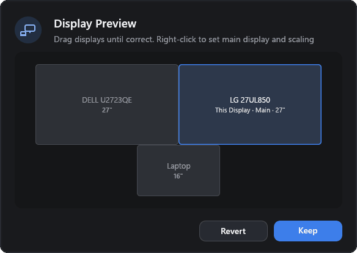
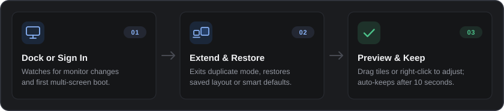
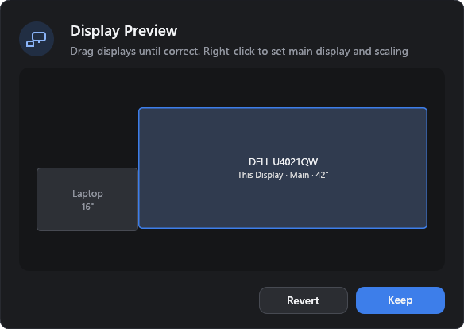
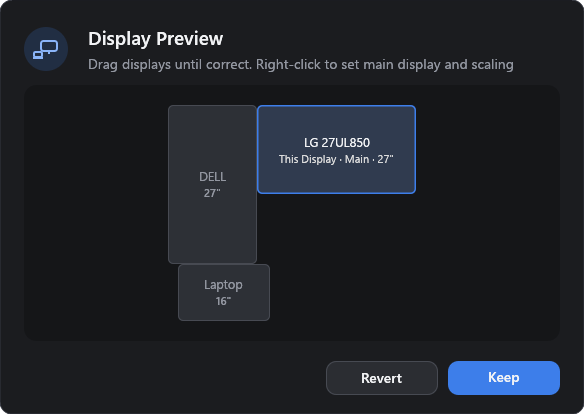

<div align="center">
  
  <h1>auto-display</h1>
  <p><strong>Stop Windows laptops from duplicating screens when you dock.</strong><br>
  Automatically switches to extend, restores your layout and DPI scaling, and gives you a to-scale preview card.</p>

  <p>
    <a href="https://github.com/pepsi-enjoyer/auto-display/releases/latest">
      
    </a>
    
    
  </p>
</div>

<p align="center">
  
</p>

## Quick Install

Run in PowerShell on 64-bit Windows (no admin rights or Rust required):

```powershell
irm https://raw.githubusercontent.com/pepsi-enjoyer/auto-display/master/install.ps1 | iex
```

Downloads the [latest release](https://github.com/pepsi-enjoyer/auto-display/releases/latest), verifies its SHA-256 checksum, installs to `%LOCALAPPDATA%\auto-display`, adds `auto-display` to your user `PATH`, and starts the background watcher now and at sign-in. Run the same command again to update without losing your settings.

<details>
<summary>Other installation methods (manual download or Cargo)</summary>

- **Manual download:** Grab `auto-display.exe` from [Releases](https://github.com/pepsi-enjoyer/auto-display/releases/latest), run `.\auto-display.exe install`, then reopen PowerShell to pick up the `PATH` change.
- **Build from source with [Rust](https://rustup.rs):**
  ```powershell
  cargo install --git https://github.com/pepsi-enjoyer/auto-display --locked
  auto-display install
  ```

</details>

## How It Works

<p align="center">
  
</p>

- **First multi-screen setup after boot:** Arranges your displays and opens the Display Preview card on every screen, duplicated or not.
- **Later docks:** Silently switches back to extend if plugging in a monitor leaves displays duplicated (no card).
- **Manual duplicate mode:** If you switch to Duplicate yourself later (for example, to present), `auto-display` leaves it alone.
- **Auto-updates:** Checks GitHub 1 minute after sign-in and every 6 hours, verifies the download, and restarts the watcher without changing your layout.

> [!NOTE]
> Windows does not redraw the taskbar properly after a DPI scaling change, so `auto-display` restarts Explorer when scaling changes. This closes open File Explorer windows. Set `restart_explorer = false` in `config.toml` to disable it.

## Display Preview

The card draws each screen to scale from its reported physical dimensions — including mixed orientations and portrait monitors.

| Control | Action |
|---|---|
| **Drag a tile** | Slide displays along edges and into corners; detached tiles turn red until reconnected |
| **Right-click a tile** | Set as **Main display** or adjust **Scaling** (scaling applies immediately) |
| **Keep** / `Enter` | Save the layout (auto-keeps after 10 seconds if untouched) |
| **Revert** / `Esc` | Restore the layout and scaling from before setup |

When Windows has no saved layout for the connected screens, `auto-display` uses sensible defaults:

- **One external monitor:** External monitor as main, laptop on its left.
- **Two external monitors:** Side by side with the right monitor as main, laptop centered below.

<p align="center">
  
  
</p>

> [!TIP]
> Run `auto-display` anytime to open the preview card for your current screens, or `auto-display preview dual` (also `portrait`, `single`, `done`, `error`) to try it without changing anything.

## Configuration

Run `auto-display config` to create and print the path to your settings file (`%LOCALAPPDATA%\auto-display\config.toml`):

```toml
external_scale = 150      # scaling for a 4K external monitor (%)
# laptop_scale = 250      # scaling for the laptop screen; omit to keep Windows' choice
auto_update = true        # set to false to disable automatic updates
restart_explorer = true   # set to false to keep Explorer running after scaling changes
```

External monitors scale proportionally by their shorter pixel edge (2160 px = 4K baseline), rounded to the nearest Windows scaling step:

| Monitor Resolution | Short Edge | Applied Scale (at `external_scale = 150`) |
|---|---:|---:|
| 4K / 5K2K (`3840x2160`, `5120x2160`, `2160x3840`) | 2160 px | **150%** |
| 1440p (`2560x1440`) | 1440 px | **100%** |
| 1080p (`1920x1080`) | 1080 px | **100%** |

## Commands

| Command | What it does |
|---|---|
| `auto-display` | Set up displays now and show the Display Preview card |
| `auto-display status` | Show connected displays, physical sizes, scaling, and watcher status |
| `auto-display layout` | Apply layout and scaling now without showing the card |
| `auto-display laptop left\|right\|below` | Move the laptop screen relative to external monitors |
| `auto-display swap` | Swap two side-by-side external monitors |
| `auto-display taskbar` | Restart Explorer so the taskbar matches the current scaling |
| `auto-display config` | Create `config.toml` if needed and print its path |
| `auto-display update` | Check for and install a newer GitHub release now |
| `auto-display preview [kind]` | Demo the card (`dual`, `portrait`, `single`, `done`, `error`) safely |
| `auto-display uninstall` | Stop the watcher and remove it from sign-in and your user `PATH` |

Logs are written to `%LOCALAPPDATA%\auto-display\auto-display.log`.
